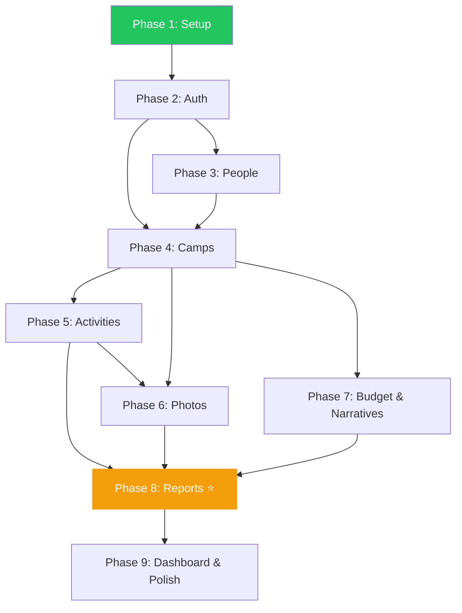

# MVP Implementation Roadmap

> Complete phase-by-phase plan from project setup through report generation and deployment readiness.

---

## Phase Overview

| Phase | Name | Status | Complexity |
|-------|------|--------|------------|
| 1 | Project Setup & Foundation | ✅ **Complete** | Medium |
| 2 | Authentication & Session Management | ✅ **Complete** | Medium |
| 3 | People Registry | ✅ **Complete** | Low–Medium |
| 4 | Camp Management | ✅ **Complete** | High |
| 5 | Activity Management | ✅ **Complete** | Medium |
| 6 | Photo Documentation | ✅ **Complete** | High |
| 7 | Budget & Narrative Sections | ⏳ **Partially Completed** (Budget Complete, Narrative Pending) | Medium |
| 8 | Report Generation ⭐ | 🔲 Pending | Very High |
| 9 | Dashboard, Polish & Deployment | 🔲 Pending | Medium |

> **Note on implementation milestones:** Approved architectural improvements are delivered *between* Blueprint phases, without changing this roadmap's phase numbering or sequence (no phases are renumbered or split, e.g. no "Phase 5.5"). Implementation milestones are documented separately in `docs/IMPLEMENTATION_001_ROLE_BASED_WORKSPACES.md`. Currently, **Implementation 001 — Role-Based Workspaces** is **Completed** (Deliverables 1 through 5 completed).

---

## Phase 1 — Project Setup & Foundation

**Status:** ✅ Complete
**Commit:** `358dc52f2ad2735bdc9e0d71733ae9de5ea037d7`
**Branch:** `main`

### Objective

Establish the project skeleton, design system, database schema, authentication foundation, shared UI components, and role-based routing infrastructure.

### Deliverables (Completed)

| Category | Deliverables |
|----------|-------------|
| **Build** | Vite 8 + React 19 + TypeScript 6 (strict) + Tailwind CSS v4 |
| **Design System** | oklch color palette, Inter font, custom CSS tokens, animations |
| **UI Components** | Button, Input, Card, Badge, Spinner, EmptyState |
| **Layouts** | AppShell (sidebar), VolunteerLayout (mobile bottom nav) |
| **Auth Foundation** | authService, authStore (Zustand), useAuth hook |
| **Routing** | React Router v7, ProtectedRoute guard, role-based route groups |
| **Pages** | LoginPage, DashboardPage, UnauthorizedPage, VolunteerHomePage |
| **Database** | Complete schema (11 tables), indexes, RLS policies, helper functions |
| **Data** | Seed script with demo persons |
| **Config** | Constants, database types, utility functions, env templates |
| **Documentation** | README, PHASE_01_SETUP.md |

### Files (42)

All source code, configuration, SQL migrations, and documentation listed in `docs/PHASE_01_SETUP.md`.

---

## Phase 2 — Authentication & Session Management

**Status:** ✅ Complete (see `docs/PHASE_02_AUTH.md`)
**Estimated Complexity:** Medium

### Objective

Complete the end-to-end authentication flow. Ensure users can sign in, maintain sessions, and be routed to the correct interface based on their role.

### Features

1. **Login flow** — Wire LoginPage to Supabase Auth (email + password)
2. **Session persistence** — Maintain session across page refreshes and browser tabs
3. **Role resolution** — After auth, fetch the user's app-level role from `users` → `roles`
4. **Role-based redirect** — Faculty/Admin → Dashboard, Volunteer → Volunteer Home
5. **Logout** — Clear session, redirect to login
6. **Auth error handling** — Invalid credentials, expired sessions, disabled accounts

### Deliverables

| Deliverable | Description |
|-------------|-------------|
| Working login/logout flow | Supabase Auth integration tested with real credentials |
| Session listener | `onAuthStateChange` handling in useAuth hook |
| Role-based routing | Automatic redirect based on resolved role |
| Error states | User-facing error messages for all auth failure scenarios |
| Test users | At least 3 test users created in Supabase (faculty, team_lead, volunteer) |

### Dependencies

- Supabase project configured with Auth enabled
- `.env` populated with real `VITE_SUPABASE_URL` and `VITE_SUPABASE_ANON_KEY`
- `001_complete_schema.sql` executed in Supabase SQL editor
- Test auth users created in Supabase Auth dashboard

### Success Criteria

- [ ] Faculty user logs in → sees Dashboard with sidebar
- [ ] Volunteer user logs in → sees Volunteer Home with bottom nav
- [ ] Invalid credentials → shows error message
- [ ] Page refresh → session persists (no re-login)
- [ ] Logout → redirects to login, session cleared
- [ ] Unauthenticated access to `/dashboard` → redirects to `/login`
- [ ] Volunteer access to `/dashboard` → redirects to `/unauthorized`

---

## Phase 3 — People Registry

**Status:** ✅ Complete (see `docs/PHASE_03_PEOPLE.md`)
**Estimated Complexity:** Low–Medium

### Objective

Build the people management module. Faculty can create and manage person records (faculty, students, external guests) that will be assigned to camps in Phase 4.

### Features

1. **Person list** — Searchable, filterable table of all persons
2. **Person create** — Form with category (faculty/student/external), name, designation, organization, contact
3. **Person edit** — Update existing person records
4. **Category filtering** — Filter by faculty, student, external
5. **Search** — Search by name, designation, or organization

### Deliverables

| Deliverable | Description |
|-------------|-------------|
| `PersonService` | Supabase CRUD operations for `persons` table |
| `PeopleListPage` | Paginated table with search and category filters |
| `PersonFormModal` | Create/edit form with Zod validation |
| Route integration | `/people` route wired into AppShell |

### Dependencies

- Phase 2 complete (authenticated users with roles)
- `persons` table exists (Phase 1 migration)

### Success Criteria

- [ ] Faculty can create a new person (all categories)
- [ ] Person list renders with search and filter
- [ ] Edit existing person record
- [ ] Validation prevents empty names or invalid data
- [ ] RLS enforces faculty/admin-only write access

---

## Phase 4 — Camp Management

**Status:** ✅ Complete (see `docs/PHASE_04_CAMPS.md`)
**Estimated Complexity:** High

### Objective

Build the core camp management module — the central entity of the entire platform. Faculty can create camps, configure settings, and assign people to camp-specific roles.

### Features

1. **Camp list** — Cards or table showing all camps with status badges
2. **Camp create** — Multi-section form: details, location, timing, report settings
3. **Camp detail** — Tabbed view showing all camp sub-entities
4. **Camp edit** — Update camp metadata and settings
5. **Camp status management** — Transition: draft → active → completed → archived
6. **People assignment** — Assign persons to camp with specific roles (faculty_coordinator, guest, volunteer, team_lead)
7. **People removal** — Remove assignments

### Deliverables

| Deliverable | Description |
|-------------|-------------|
| `CampService` | Full CRUD + status transitions for `camps` table |
| `CampPeopleService` | Manage `camp_people` assignments |
| `CampListPage` | Camp cards with status filters and search |
| `CampCreatePage` | Multi-section creation form |
| `CampDetailPage` | Tabbed layout (Overview, Activities, Photos, Budget, Narratives, People, Report) |
| `CampPeopleTab` | Assign/remove persons with role selection |
| `campStore` | Zustand store for active camp context |

### Dependencies

- Phase 2 complete (auth)
- Phase 3 complete (persons to assign)

### Success Criteria

- [x] Faculty creates a camp with all required fields
- [x] Camp list shows status badges and counts
- [x] Camp detail page loads with tabbed navigation
- [x] People can be assigned and removed from camps
- [x] Status transitions work correctly
- [x] RLS enforces permission matrix
- [x] TypeScript check passes (`npx tsc --noEmit`)
- [x] Production build passes (`npm run build`)
- [x] Supabase project created and schema executed successfully
- [x] Database tables and roles confirmed in Supabase
- [x] Frontend connects to Supabase successfully
- [x] Login page reaches Supabase Auth (confirmed via credential error response)

---

## Phase 5 — Activity Management

**Status:** ✅ Complete (see `docs/PHASE_05_ACTIVITY_MANAGEMENT.md`)
**Estimated Complexity:** Medium

### Objective

Build activity management within camps. Faculty define ordered activities; volunteers and team leads update activity status during camp execution.

### Features

1. **Activity list** — Ordered list within camp detail (Activities tab)
2. **Activity create** — Select from predefined list or enter custom name
3. **Activity reorder** — Drag-and-drop to set `activity_order`
4. **Activity status** — Transition: planned → active → completed
5. **Activity delete** — Remove activity (cascade deletes associated photos)
6. **Predefined templates** — Quick-add from standard activity list (Inauguration, Welcome Address, etc.)

### Deliverables

| Deliverable | Description |
|-------------|-------------|
| `ActivityService` | CRUD + `updateActivityStatus` + `reorderActivities` operations for `activities` table |
| `ActivitiesTab` | Activity list component within CampDetailPage, with drag-and-drop reordering |
| `ActivityForm` | Create/edit with predefined dropdown + "Other / Custom Activity" option |
| Drag-and-drop reorder | @dnd-kit integration for activity ordering — implemented |
| `activityStore` | Deferred to Phase 6 — not needed until volunteer photo capture requires "current activity" context |

### Dependencies

- Phase 4 complete (camps exist to contain activities)

### Success Criteria

- [x] Faculty adds activities to a camp (predefined + custom)
- [x] Activities display in correct order
- [x] Drag-and-drop reorder persists to database
- [x] Activity status transitions work
- [x] Deleting an activity cascades to its photos (DB `ON DELETE CASCADE`)
- [x] Team leads can update activity status (UI-level; RLS/permission enforcement per the permission matrix is a DB-level concern, unchanged by this milestone)

---

## Phase 6 — Photo Documentation

**Status:** ✅ Complete (see `docs/PHASE_6.md`)
**Estimated Complexity:** High

### Objective

Build the photo capture and curation workflow — the bridge between field work and report content. Volunteers capture photos during camp; faculty review, select, and curate for reports.

### Features

#### Volunteer Side (Mobile)
1. **Activity selector** — Choose current activity before capturing
2. **Photo capture** — Camera integration or file upload
3. **Geo-tagging** — Capture GPS coordinates with photo (if permitted)
4. **Upload queue** — Upload to Supabase Storage with progress indicator
5. **My submissions** — View own uploaded photos

#### Faculty Side (Desktop)
6. **Photo gallery** — All photos for a camp, grouped by activity
7. **Photo review** — Full-size preview with metadata
8. **Report selection** — Toggle `is_selected_for_report` flag
9. **Batch operations** — Select/deselect multiple photos

### Deliverables

| Deliverable | Description |
|-------------|-------------|
| `PhotoService` | Upload to Storage, CRUD on `photos` table, signed URL generation |
| `PhotoCapturePage` | Volunteer mobile capture interface (`VolunteerCapturePage.tsx`) |
| `PhotoGalleryTab` | Faculty photo review within CampDetailPage (`PhotosTab.tsx`) |
| `PhotoCard` | Thumbnail with selection toggle and metadata (`PhotoThumbnail.tsx`) |
| `VolunteerSubmissions` | Volunteer's own photo history (`MySubmissionsPage.tsx`) |
| Storage bucket setup | `camp-photos` bucket schema definitions |

### Dependencies

- Phase 4 complete (camps)
- Phase 5 complete (activities to tag photos to)
- Supabase Storage configured with `camp-photos` bucket

### Success Criteria

- [x] Volunteer captures/uploads photo linked to current activity
- [x] Photo stored in Supabase Storage with signed URL
- [x] GPS coordinates captured (when available)
- [x] Faculty sees all photos in gallery, grouped by activity
- [x] Faculty can select/deselect photos for report
- [x] `max_photos_per_activity` limit enforced per report settings

---

## Phase 7 — Budget & Narrative Sections

**Status:** ⏳ **Partially Completed**
- **Completed**: Budget Module
- **Remaining**: Narrative Sections
**Estimated Complexity:** Medium

### Objective

Build the two data-entry modules feeding into report content: expense tracking and narrative text blocks.

### Scope & Breakdown

#### Completed Deliverables (Budget Module)
- **Budget Dashboard**: 4 financial metric cards (Allocated Budget, Total Spent, Remaining Budget, Expense Count).
- **Expense CRUD**: Full management of expense items (`category`, `description`, `unit_cost`, `quantity`, `total_amount`, `expense_date`, `remarks`, `receipt_url`).
- **Budget Reporting**: Client-side PDF statement generation (`jspdf`) with Legal Aid sign-off signature blocks (`Faculty Coordinator Signature`, `Student Team Lead Signature`).
- **Workspace Integration**: Shared `BudgetTab` implementation integrated across both Faculty (`/camps/:campId`) and Team Lead (`/team-lead/budget`) workspaces.
- **Budget RBAC**: Faculty control over `allocated_budget`, shared expense management for Faculty and Team Lead, complete restriction for Volunteers.
- **Database Alignment**: Idempotent SQL migration `003_budget_schema_alignment.sql` with RLS policies updated for `admin`, `faculty`, and `team_lead`.

#### Pending Deliverables (Narrative Module)
- **Narrative Section Editors**: Editors for 5 narrative section types (*Synopsis*, *Objectives*, *Observations*, *Recommendations*, *Conclusion*).
- **Narrative Auto-Save**: Auto-save on blur or with debounce.
- **Narrative Templates**: Pre-populated template blocks for institutional reporting.
- **Report Integration**: Feeding narrative text into the composite Report Generator (Phase 8).

### Success Criteria

- [x] Faculty sets allocated budget and adds expense line items with Zod validation
- [x] Grand total, category breakdowns, and remaining budget compute automatically with safe fallback
- [x] Team Lead accesses shared budget workspace with expense management enabled and allocated limit editing hidden
- [x] RLS enforces strict role permissions across `admin`, `faculty`, and `team_lead`
- [ ] All 5 narrative sections editable per camp
- [ ] Auto-save persists narrative changes without explicit submit

---

## Phase 8 — Report Generation ⭐

**Status:** 🔲 Pending
**Estimated Complexity:** Very High

> This is the flagship feature. All previous phases exist to feed data into this module.

### Objective

Build the automated report generator that assembles all camp data into a professional institutional report, output as PDF and optionally DOCX.

### Features

1. **Report data assembly** — Aggregate camp, people, activities, photos, expenses, narratives, survey stats into `CampReportData`
2. **Report preview** — Render the full report in-browser before generating
3. **PDF generation** — HTML template → html2canvas → jsPDF output
4. **DOCX generation** — Template-based generation via docxtemplater
5. **Report versioning** — Track version number per camp
6. **Report storage** — Upload generated files to `camp-reports` bucket
7. **Report history** — List of previously generated reports per camp
8. **Download** — Direct download of generated PDF/DOCX files

### Report Template Sections

1. Cover Page
2. Camp Details (date, time, venue, description)
3. Faculty & Guests (names, designations)
4. Objectives
5. Synopsis
6. Activity Report (each activity + selected photos)
7. Observations
8. Survey Summary (if enabled)
9. Budget Table (if enabled)
10. Recommendations
11. Conclusion
12. Volunteer List
13. Photo Gallery

### Deliverables

| Deliverable | Description |
|-------------|-------------|
| `ReportService` | Data assembly + PDF/DOCX generation logic |
| `ReportDataAssembler` | Fetch and structure all camp data |
| `ReportPreview` | In-browser HTML rendering of full report |
| `ReportTab` | Report management within CampDetailPage |
| HTML report template | Styled institutional template for PDF capture |
| DOCX template | docxtemplater template file |
| `GenerateReportButton` | One-click generation with progress indicator |
| `ReportHistoryList` | Versioned report list with download links |
| Storage bucket setup | `camp-reports` bucket with RLS policies |

### Dependencies

- Phase 4 complete (camps + people)
- Phase 5 complete (activities)
- Phase 6 complete (curated photos)
- Phase 7 complete (budget + narratives)

### Success Criteria

- [ ] Report preview renders all 13 sections correctly
- [ ] PDF generates with correct formatting and embedded photos
- [ ] DOCX generates with correct template binding
- [ ] Report stored in Supabase Storage with version tracking
- [ ] Download links work for both formats
- [ ] Empty sections handled gracefully (omitted or show placeholder)
- [ ] Report settings respected (budget inclusion, photo limits)
- [ ] Faculty can regenerate report (version increments)

---

## Phase 9 — Dashboard, Polish & Deployment Readiness

**Status:** 🔲 Pending
**Estimated Complexity:** Medium

### Objective

Build the statistics dashboard, polish the UI, fix edge cases, optimize performance, and ensure the app is deployment-ready.

### Features

1. **Dashboard stats** — Live counts: total camps, active camps, volunteers, reports generated
2. **Recent activity feed** — Latest actions across camps
3. **Camp completion indicators** — Progress bars showing documentation completeness
4. **Loading states** — Skeleton screens for all data-fetching components
5. **Error boundaries** — Graceful error handling throughout the app
6. **Responsive polish** — Ensure all pages work on tablet and mobile
7. **Performance** — Code splitting, lazy loading for route-level components
8. **Accessibility** — Keyboard navigation, ARIA labels, focus management
9. **SEO** — Meta tags, page titles
10. **Build optimization** — Analyze and reduce bundle size

### Deliverables

| Deliverable | Description |
|-------------|-------------|
| `DashboardService` | Aggregate queries for stats and recent activity |
| Updated `DashboardPage` | Live stats, recent activity, completion indicators |
| Error boundaries | React error boundary components |
| Skeleton components | Loading states for lists, cards, tables |
| Code splitting | React.lazy + Suspense for route-level chunks |
| Production build | Verified `npm run build` with no warnings |
| Deployment guide | Documentation for deploying to Vercel/Netlify |

### Dependencies

- All previous phases complete

### Success Criteria

- [ ] Dashboard shows live, accurate statistics
- [ ] All pages have loading and error states
- [ ] Production build succeeds with no errors
- [ ] Bundle size optimized (code splitting reduces initial load)
- [ ] App is functional on desktop, tablet, and mobile
- [ ] Complete end-to-end workflow: Create camp → Document → Generate report

---

## Dependency Graph

---

## Timeline Estimate

| Phase | Effort | Cumulative |
|-------|--------|------------|
| Phase 1 ✅ | Complete | — |
| Phase 2 ✅ | Complete | — |
| Phase 3 ✅ | Complete | — |
| Phase 4 ✅ | Complete | — |
| Phase 5 ✅ | Complete | — |
| Phase 6 | 2 sessions | 2 sessions |
| Phase 7 | 1 session | 3 sessions |
| Phase 8 | 2–3 sessions | 5–6 sessions |
| Phase 9 | 1–2 sessions | 6–8 sessions |

*"Session" = one focused development cycle with AI assistance.*
