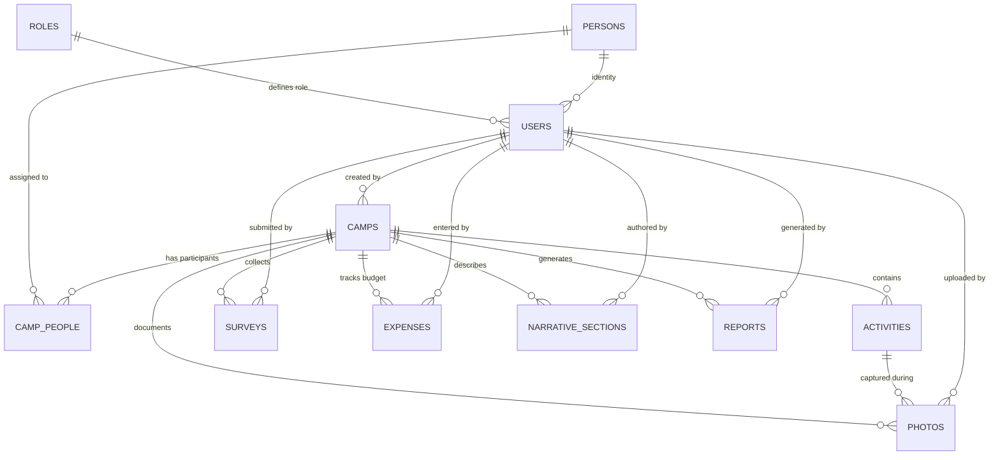

# Project Blueprint — Legal Aid Camp Documentation & Report Automation Platform

> Master specification document. This is the single authoritative reference for what the product is, how it works, and why it exists.

---

## 1. Vision

Eliminate the administrative burden of documenting legal aid camps and generating institutional reports. Faculty should focus on legal outreach — not paperwork.

## 2. Problem Statement

University legal aid committees conduct camps in rural areas involving multiple activities, volunteers, faculty, and guests. After each camp, faculty must manually:

1. Collect photos from 10–30 volunteer phones
2. Sort, label, and organize photos by activity
3. Write narrative sections (synopsis, objectives, observations)
4. Track budget and expenses
5. Compile everything into a formatted institutional report (PDF/DOCX)

This process takes **days of manual effort per camp** and produces inconsistent outputs. Photos get lost, narratives are forgotten, and reports are delayed.

## 3. Core Value Proposition

> **Enter Once → Use Everywhere**

Every piece of information — a camp name, an activity, a photo, a budget line — is entered exactly once and automatically flows into:

- Camp documentation
- Activity summaries
- Photo galleries
- Budget tables
- Narrative sections
- **Automated institutional reports**

## 4. Business Objective

Reduce the end-to-end camp documentation and report generation cycle from **days to minutes**.

Specifically:
- Real-time photo capture during camps (not post-camp collection)
- Structured data entry (not free-form documents)
- One-click report generation (not manual compilation)

## 5. MVP Success Criteria

| Criteria | Target |
|----------|--------|
| Camp CRUD | Faculty can create, edit, and manage camps |
| Activity management | Ordered activities with status tracking |
| Photo documentation | Volunteers capture and upload during camp |
| Photo curation | Faculty select photos for inclusion in reports |
| Narrative sections | Faculty write synopsis, objectives, observations, recommendations, conclusion |
| Budget tracking | Line-item expense entry with auto-totals |
| Report generation | One-click PDF output with all camp data assembled |
| Role-based access | Faculty, Team Lead, Volunteer — each sees only what they need |

---

## 6. System Overview

### 6.1 Camp-Centric Architecture

The **Camp** is the primary entity. Everything in the system exists in relation to a camp.

```
Camp
├── Activities (ordered list of camp events)
│   └── Photos (captured per activity)
├── People
│   ├── Faculty Coordinators
│   ├── Guests / Chief Guests
│   ├── Team Leads
│   └── Volunteers
├── Expenses (budget line items)
├── Narrative Sections
│   ├── Synopsis
│   ├── Objectives
│   ├── Observations
│   ├── Recommendations
│   └── Conclusion
├── Surveys (reference links to external survey system)
└── Reports (generated PDF/DOCX documents)
```

### 6.2 What This System Is NOT

- **NOT a survey platform.** Survey collection, analytics, and reporting are handled by a separate system. This platform only stores survey reference IDs and aggregate stats for inclusion in reports.
- **NOT a general-purpose CMS.** It is purpose-built for legal aid camp documentation.
- **NOT a student management system.** Person records exist solely to populate camp rosters and reports.

### 6.3 Camp Lifecycle

```
┌─────────┐     ┌─────────┐     ┌───────────┐     ┌──────────┐
│  DRAFT  │ ──▸ │ ACTIVE  │ ──▸ │ COMPLETED │ ──▸ │ ARCHIVED │
└─────────┘     └─────────┘     └───────────┘     └──────────┘
     │               │                │
     │               │                │
  Faculty         Volunteers       Faculty
  sets up         capture          reviews,
  camp data       photos           writes
                  during           narratives,
                  camp             generates
                                   report
```

| Status | Who Acts | What Happens |
|--------|----------|--------------|
| **Draft** | Faculty | Create camp, add activities, assign people, enter budget |
| **Active** | Volunteers, Team Leads | Photo capture, survey submission, activity status updates |
| **Completed** | Faculty | Review photos, write narratives, select report photos, generate report |
| **Archived** | — | Read-only historical record |

---

## 7. User Roles

### 7.1 Role Definitions

| Role | Description | Primary Interface |
|------|-------------|-------------------|
| **Admin** | System administrator with full access | Desktop (AppShell) |
| **Faculty** | Faculty coordinator who manages camps and generates reports | Desktop (AppShell) |
| **Team Lead** | Senior student who monitors activities and reviews documentation | Desktop (AppShell) |
| **Volunteer** | Student who captures photos and submits data during camps | Mobile (VolunteerLayout) |

### 7.2 Permission Matrix

| Resource | Admin | Faculty | Team Lead | Volunteer |
|----------|-------|---------|-----------|-----------|
| **Camps** — Create | ✅ | ✅ | ❌ | ❌ |
| **Camps** — Read | ✅ | ✅ | ✅ (assigned) | ✅ (assigned) |
| **Camps** — Update | ✅ | ✅ | ❌ | ❌ |
| **Camps** — Delete | ✅ | ❌ | ❌ | ❌ |
| **Activities** — CRUD | ✅ | ✅ | Update only | ❌ |
| **People** — CRUD | ✅ | ✅ | ❌ | ❌ |
| **Photos** — Upload | ✅ | ✅ | ✅ | ✅ |
| **Photos** — Select for report | ✅ | ✅ | ❌ | ❌ |
| **Photos** — Update own | ✅ | ✅ | ✅ | ✅ |
| **Expenses** — CRUD | ✅ | ✅ | ❌ | ❌ |
| **Narratives** — Read | ✅ | ✅ | ✅ | ❌ |
| **Narratives** — Write | ✅ | ✅ | ❌ | ❌ |
| **Reports** — Generate | ✅ | ✅ | ❌ | ❌ |
| **Surveys** — Submit | ✅ | ✅ | ✅ | ✅ |

---

## 8. Database Architecture

### 8.1 Entity Overview (11 Tables)

| # | Table | Purpose | FK Parent |
|---|-------|---------|-----------|
| 1 | `roles` | System role definitions (admin, faculty, team_lead, volunteer) | — |
| 2 | `persons` | People registry (faculty, students, external guests) | — |
| 3 | `users` | App users linking Supabase auth to persons and roles | `roles`, `persons` |
| 4 | `camps` | Camp events — the central entity | `users` (created_by) |
| 5 | `camp_people` | Many-to-many: assigns persons to camps with specific roles | `camps`, `persons` |
| 6 | `activities` | Ordered list of activities within a camp | `camps` |
| 7 | `photos` | Photo records with geo-coordinates and report selection flag | `camps`, `activities`, `users` |
| 8 | `surveys` | Survey reference records (links to external survey system) | `camps`, `users` |
| 9 | `expenses` | Budget line items with unit cost × quantity | `camps`, `users` |
| 10 | `narrative_sections` | Structured narrative text blocks (one per type per camp) | `camps`, `users` |
| 11 | `reports` | Generated report records with PDF/DOCX URLs and versioning | `camps`, `users` |

### 8.2 Entity Relationship Diagram



### 8.3 Key Schema Details

**Camp fields:**
- `camp_name`, `description`, `camp_date`, `start_time`, `end_time`
- Location: `village_name`, `taluk`, `district`
- `status`: draft → active → completed → archived
- `report_settings` (JSONB): `include_budget`, `include_survey_stats`, `max_photos_per_activity`

**Photos:**
- Linked to both `camp_id` AND `activity_id`
- Optional GPS: `latitude`, `longitude`
- `is_selected_for_report`: boolean flag for report inclusion
- Stored in private Supabase Storage bucket (`camp-photos`)

**Narrative sections:**
- Unique constraint: one section per `section_type` per camp
- Types: `synopsis`, `objectives`, `observations`, `recommendations`, `conclusion`

**Expenses:**
- `expense_type`, `unit_cost`, `quantity`, `total_amount`
- `total_amount` is stored (not computed) for audit integrity

### 8.4 Row Level Security

All 11 tables have RLS enabled. Two helper functions simplify policies:

- `get_user_role()` — returns the authenticated user's app role name
- `get_app_user_id()` — returns the authenticated user's app-level UUID

Policies enforce the permission matrix defined in Section 7.2.

### 8.5 Storage Buckets

| Bucket | Visibility | Purpose |
|--------|-----------|---------|
| `camp-photos` | Private | Volunteer-uploaded camp photos |
| `camp-reports` | Private | Generated PDF/DOCX reports |

Access via signed URLs only.

---

## 9. Report Generation — The Flagship Feature

### 9.1 Report Data Assembly

When a faculty member clicks "Generate Report", the system assembles `CampReportData`:

```typescript
interface CampReportData {
  camp: Camp;                          // Camp metadata + location
  faculty: CampPersonWithDetails[];    // Faculty coordinators
  guests: CampPersonWithDetails[];     // Chief guests / guests
  volunteers: CampPersonWithDetails[]; // Student volunteers
  activities: Activity[];              // Ordered activity list
  photos: Photo[];                     // Selected photos only
  expenses: Expense[];                 // Budget table rows
  narratives: NarrativeSection[];      // All 5 narrative blocks
  surveyStats: SurveyStats | null;     // Aggregate survey counts
}
```

### 9.2 Report Output Structure

The generated report follows this institutional template:

1. **Cover Page** — Camp name, date, location, university branding
2. **Camp Details** — Date, time, venue, description
3. **Faculty & Guests** — Names, designations, organizations
4. **Objectives** — From narrative section
5. **Synopsis** — From narrative section
6. **Activity Report** — Each activity with selected photos
7. **Observations** — From narrative section
8. **Survey Summary** — Aggregate stats (if enabled)
9. **Budget Summary** — Expense table with totals (if enabled)
10. **Recommendations** — From narrative section
11. **Conclusion** — From narrative section
12. **Volunteer List** — Names and designations
13. **Photo Gallery** — Additional selected photos

### 9.3 Technical Approach

| Format | Technology | Strategy |
|--------|-----------|----------|
| **PDF** | jsPDF + html2canvas | Render HTML template → capture as canvas → output PDF |
| **DOCX** | docxtemplater + PizZip | Template-based generation with data binding |

The `ReportService` abstraction layer handles both formats, allowing the rendering strategy to evolve independently of the data assembly logic.

---

## 10. UX Principles

### 10.1 Student / Volunteer Experience

- **Mobile-first**: Bottom navigation, large touch targets, minimal text input
- **Camera-native**: Photo capture is the primary action
- **Context-aware**: Volunteer sees only their assigned camp and current activity
- **Minimal cognitive load**: No admin features, no configuration, no settings
- **Offline-resilient** (future): Queue uploads when connectivity is poor

### 10.2 Faculty / Admin Experience

- **Desktop-optimized**: Sidebar navigation, wide-screen data tables, multi-pane layouts
- **Dashboard-driven**: At-a-glance camp status, photo counts, completion progress
- **Batch operations**: Select multiple photos, reorder activities via drag-and-drop
- **Report preview**: See the report before generating — no surprises
- **One-click output**: Generate PDF/DOCX with a single button press

---

## 11. Technology Stack

| Layer | Technology | Version | Purpose |
|-------|-----------|---------|---------|
| **Framework** | React | 19 | UI components and routing |
| **Language** | TypeScript | 6 (strict) | Type safety across the entire codebase |
| **Build** | Vite | 8 | Fast dev server and production bundling |
| **Styling** | Tailwind CSS | 4 | Utility-first CSS with custom design tokens |
| **State** | Zustand | 5 | Lightweight global state (auth, UI, context) |
| **Forms** | React Hook Form + Zod | 7 / 4 | Validated form management |
| **Routing** | React Router | 7 | Role-based route groups with guards |
| **Backend** | Supabase | 2 | PostgreSQL, Auth, Storage, RLS |
| **PDF** | jsPDF + html2canvas | — | Client-side PDF generation |
| **DOCX** | docxtemplater + PizZip | — | Template-based DOCX generation |
| **Icons** | Lucide React | — | Consistent icon library |
| **Drag & Drop** | @dnd-kit | — | Activity reordering |
| **Dates** | date-fns | 4 | Date formatting and manipulation |

---

## 12. Project Structure

```
legal-aid-camp-platform/
├── docs/                          # Project documentation
├── public/                        # Static assets
├── supabase/
│   ├── migrations/                # SQL schema migrations
│   │   └── 001_complete_schema.sql
│   └── seed.sql                   # Demo data
├── src/
│   ├── app/                       # App root, router
│   │   ├── App.tsx
│   │   └── routes.tsx
│   ├── components/
│   │   ├── guards/                # Route protection
│   │   │   └── ProtectedRoute.tsx
│   │   ├── layout/                # Page shells
│   │   │   ├── AppShell.tsx       # Faculty/Admin layout
│   │   │   ├── Sidebar.tsx        # Collapsible sidebar
│   │   │   └── VolunteerLayout.tsx # Mobile layout
│   │   └── ui/                    # Shared UI primitives
│   │       ├── Badge.tsx
│   │       ├── Button.tsx
│   │       ├── Card.tsx
│   │       ├── EmptyState.tsx
│   │       ├── Input.tsx
│   │       └── Spinner.tsx
│   ├── constants/                 # Enums, statuses, routes, config
│   ├── features/                  # Feature modules (self-contained)
│   │   └── auth/
│   │       ├── components/        # LoginPage
│   │       ├── hooks/             # useAuth
│   │       └── services/          # authService
│   ├── pages/                     # Top-level page components
│   ├── services/                  # Supabase client
│   ├── store/                     # Zustand stores
│   ├── types/                     # Database type definitions
│   └── utils/                     # Helpers and formatters
├── index.html
├── package.json
├── tsconfig.json
└── vite.config.ts
```

### Feature Module Convention

Each feature follows this internal structure:

```
features/<feature>/
├── components/    # React components specific to this feature
├── hooks/         # Custom hooks (data fetching, state)
├── services/      # Supabase API calls for this feature
└── types/         # Feature-specific type extensions
```

---

## 13. Architectural Decisions

| Decision | Rationale |
|----------|-----------|
| **Supabase (not custom API)** | Auth, DB, storage, and RLS in one managed service. Eliminates backend boilerplate for MVP. |
| **Client-side report generation** | No server-side rendering needed. jsPDF + html2canvas runs entirely in the browser. |
| **Zustand (not Redux/Context)** | Minimal boilerplate for auth state, UI state. No server cache layer — Supabase queries are direct. |
| **Feature-based folders** | Each feature is self-contained. Prevents cross-feature coupling. |
| **Single SQL migration** | All 11 tables in one file for MVP simplicity. Can be split into incremental migrations later. |
| **RLS helper functions** | `get_user_role()` and `get_app_user_id()` avoid repeated auth joins in every policy. |
| **Tailwind CSS v4** | New `@theme` directive for design tokens. No PostCSS config needed with Vite plugin. |
| **TypeScript strict mode** | Catches bugs early. `noUnusedLocals` + `noUnusedParameters` enforced. |
| **Separate persons and users tables** | Not all people who appear in reports are system users. Guests, external speakers, etc. are persons without login credentials. |
| **`is_selected_for_report` on photos** | Simple boolean flag avoids a separate junction table. Faculty toggles selection during review. |
| **JSONB `report_settings`** | Flexible per-camp report configuration without schema changes. |
| **Two layouts** | Faculty need sidebar + wide screen. Volunteers need mobile-first bottom nav. Separate shells, shared components. |

---

## 14. Future Enhancements (Post-MVP)

- Offline photo capture with background sync
- Multi-language report templates
- Bulk camp creation from templates
- Survey analytics integration (not just reference IDs)
- Role-based dashboards with live statistics
- Email/SMS notifications for camp assignments
- Export camp data as CSV/Excel
- Audit trail for all modifications
- PWA with install prompt for volunteer phones
- DOCX template editor for custom report formats

## 15. Out-of-Scope for MVP

- Survey creation, collection, or analytics (handled by separate system)
- Student attendance tracking
- Faculty performance evaluation
- Multi-university / multi-tenant support
- Public-facing pages or landing site
- Real-time collaboration (simultaneous editing)
- Push notifications
- Calendar integration
- Video documentation
- Approval workflows for reports
