# Architectural Restructure — V2 Information Architecture
## Transition from "Camp" to "Legal Aid Project"

This document details the architectural restructure of the Legal Aid Camp Management Platform. It aligns the application's vocabulary, hierarchy, navigation, and module ownership with the real-world operational flows defined by the School of Law.

---

## 1. Motivation & Background
A Legal Aid Camp is not a single-day event. Instead, every village engagement is a long-term **Legal Aid Project** consisting of multiple operational phases:
1. **Survey Phase**: Interacting with the community, assessing baseline needs, gathering data, and verifying the field site.
2. **Planning Phase**: Refining the schedule, assigning resources, and preparing educational materials based on survey results.
3. **Camp Phase**: Setting up the legal aid booths, conducting counseling, performing student activities, and documenting the execution.
4. **Final Report**: Processing survey results, reconciling expenses, compiling synopses, and generating the university-level PDF/DOCX reports.

By shifting our core construct from "Camp" to "Legal Aid Project", we provide a structurally sound mapping of the project lifecycle.

---

## 2. New Terminology

| Old Terminology | New Terminology | Scope / Context |
| :--- | :--- | :--- |
| **Camp** | **Legal Aid Project** | The core entity/record containing all sub-phases. |
| **Camp ID** | **Project ID** | Database primary key / API query parameters. |
| **Camp Status** | **Project Status** | Lifecycle states: `draft` → `active` → `completed` → `archived`. |
| **Camp Role** | **Project Role** | Roles within a project: `faculty_coordinator`, `volunteer`, `team_lead`, `guest`. |
| **Camp People** | **Project People** | The roster of individuals assigned to a specific project. |
| **Camp Budget** | **Project Budget** | Unified budget, eventually split into *Survey Budget* and *Camp Budget*. |
| — | **Survey Phase** | The phase involving planning, scheduling surveys, data gathering, and site verification. |
| — | **Camp Phase** | The phase involving the main camp day setup, counseling booths, activities, and guests. |
| — | **Final Report Phase** | The phase for generating and reviewing the consolidated draft and final reports. |

---

## 3. Complete Hierarchy

A single **Legal Aid Project** is the root container for all phases and data:

```mermaid
graph TD
    Project[Legal Aid Project] --> Overview[1. Overview]
    Project --> Survey[2. Survey Phase]
    Project --> Camp[3. Camp Phase]
    Project --> Report[4. Final Report]

    Overview --> Info[Project Metadata & Lifecycle State]

    Survey --> SurveySchedule[Schedule Survey]
    Survey --> SurveyAssign[Assign People]
    Survey --> SurveyAttendance[Survey Attendance]
    Survey --> SurveyForms[Survey Forms - Volunteer UI]
    Survey --> SurveyBudget[Survey Budget]
    Survey --> SurveyDash[Survey Dashboard: Stats, Individual Reports, Consolidated Reports]

    Camp --> CampSchedule[Schedule Camp]
    Camp --> CampAssign[Assign People]
    Camp --> CampAttendance[Camp Attendance]
    Camp --> CampGuests[Guests & Dignitaries]
    Camp --> CampActivities[Activities & Booths]
    Camp --> CampPhotos[Camp Documentation Photos]
    Camp --> CampBudget[Camp Budget]

    Report --> DraftReport[Generate Draft Report]
    Report --> ReportPreview[Interactive Preview]
    Report --> FinalReport[Generate Final Report]
```



---

## 4. Navigation Tree

### Faculty / Admin Dashboard
```
Faculty Home
├── Legal Aid Projects (Overview / List)
│   ├── Create Project (Creation Form contains only Name, Desc, Village, Taluk, District, State, Academic Year)
│   └── Project Details (Project ID Workspace)
│       ├── Overview (Project Home landing view with metadata & phase schedules)
│       ├── Survey Phase (Sub-tab workspace)
│       │   ├── Survey Dashboard (Placeholder)
│       │   ├── Schedule Survey (SurveySchedule component)
│       │   ├── Assign People (Reuses ProjectPeopleTab)
│       │   ├── Attendance (Reuses ProjectPeopleTab)
│       │   ├── Survey Forms (Placeholder / Central module; Verification photos are linked here)
│       │   └── Survey Budget (Reuses BudgetTab)
│       ├── Camp Phase (Sub-tab workspace)
│       │   ├── Activities (Reuses ActivitiesTab)
│       │   ├── Documentation Photos (Reuses PhotosTab)
│       │   ├── Camp Budget (Reuses BudgetTab)
│       │   ├── Schedule Camp (CampSchedule component)
│       │   ├── Assign People (Reuses ProjectPeopleTab)
│       │   ├── Attendance (Reuses ProjectPeopleTab)
│       │   └── Guests & Dignitaries (Placeholder)
│       └── Final Report (Cohesive single workspace)
│           ├── Workspace controls: Generate Draft, Preview Draft, Generate Final, Designer (Soon)
│           ├── Content Readiness Checklist
│           └── Synopsis & Narrative Editors (Reuses NarrativesTab)
└── People Registry
```

### Student Team Lead Workspace
```
Team Lead Home
├── Volunteer Mode (Redirect to Volunteer Portal)
├── Survey Dashboard (Project-specific surveys overview)
├── Activity Photos (Review, approve, and delete documentation photos)
├── Survey Reports (Consolidated statistical reports)
├── Project Budget (Manage phase budgets & log project expenses)
└── Final Report Review (Read-only project summary review)
```

### Student Volunteer Interface (Mobile-First Layout)
```
Volunteer Portal
├── Project Overview (Upcoming / Active / Finished status indicator)
├── Survey Phase (Enabled during Active Survey Phase)
│   └── Survey Form (Collect beneficiary data; Verification photos attached here)
├── Camp Phase (Enabled during Active Camp Phase)
│   ├── Capture Activity Photo (Camera capture of counseling/booths)
│   └── Documentation Gallery (My submissions grouped by activity)
└── My Submissions (Roster of uploaded photos and submitted surveys)
```

---

## 5. Ownership Model & Constraints

1. **Parent Containment**: All activities, surveys, photos, budgets, and assignments are tied to the **Project ID**.
2. **Phase Partitioning**:
   - **Photos**:
     - *Verification Photos* & *Survey Photos* will be attached directly to individual survey forms during Survey Engine implementation (Phase 8).
     - *Documentation Photos* (Activity captures) are linked to Camp Phase.
   - **Rosters**:
     - Staffing can differ. People can be assigned to the Survey Phase (e.g., student surveyors) or the Camp Phase (e.g., counseling students, guest speakers) independently.
   - **Budgets**:
     - Financial records are categorized by phase so that allocation and spending can be analyzed for Survey vs. Camp activities separately.

---

## 6. Implementation Strategy & Milestones

Refactoring the architecture is planned across three progressive phases:

### Phase 1: Terminology Rename — `[COMPLETED]`
- Renamed UI text, labels, page titles, React components, state variables, hooks, routes, types, and client-side service functions from "Camp" to "Project" or "Legal Aid Project".
- **Safety Rule Maintained**: Underlying database schema and column names (`camp_id`, `camp_role`, `camps` table) remain untouched.

### Phase 2: Information Architecture & Sub-Tabs Setup — `[COMPLETED]`
- Reorganized `ProjectDetailPage` layout to use a lifecycle navigation model with 4 main workspaces: Overview, Survey Phase, Camp Phase, and Final Report.
- Created sub-navigation hierarchies composing existing working modules (`ProjectPeopleTab`, `ActivitiesTab`, `PhotosTab`, `BudgetTab`) directly without code duplication.
- Reconstructed the report section into a single unified Report Workspace.

### Phase 3: Workflow Correction & Scheduling Modules — `[COMPLETED]`
- Removed project date fields from the main project creation form.
- Created Survey Schedule (`SurveySchedule.tsx`) and Camp Schedule (`CampSchedule.tsx`) components, persisting data securely via existing columns and `report_settings` JSONB.
- Upgraded the top navigation from simple text links to a properly styled segmented control.
- Removed standalone Verification Photos and Survey Photos modules from the navigation to prepare for the integrated Survey Engine.
- Updated ACCEPTED milestones list and remaining workflow roadmaps.

---

## 7. Acceptance Criteria (Milestone 3 Workflow Correctness)

1. **Workflow Form Alignment**:
   - Project creation form contains no date inputs.
2. **Phase Scheduling**:
   - Survey schedule and camp schedule are editable and viewable directly within the workspaces.
3. **No Standalone Verification/Survey Photo Tabs**:
   - Photo tabs are removed from the Survey Phase sub-navigation in preparation for Survey Forms attachment.
4. **Segmented Switcher**:
   - Workspace navigation uses structured neutral segmented control buttons.
5. **Clean Build**:
   - `npx tsc --noEmit` and `npm run build` execute successfully.

---

### Stabilization Pass: Data Isolation Audit — `[COMPLETED]`

- Fixed cross-project photo leakage by clearing state at the start of every query hook's load callback (`useProjectPhotos`, `useActivities`, `useExpenses`, `useProjectPeople`, `useNarratives`).
- Updated empty state copy in all module tabs to be project-specific and professional.
- Removed redundant "Guests & Dignitaries" sub-tab from Camp Phase (guests managed via Assign People).
- Matched SurveySchedule and CampSchedule layouts identically (Date / Hours / Location / Notes).
- Clean build verified: `npx tsc --noEmit` and `npm run build` pass with 0 errors.

---

### Final UI Polish — `[COMPLETED]`

This is the last milestone of the platform foundation phase. All subsequent work is feature-level implementation.

#### Changes Implemented

1. **Delete Project workflow** (`ProjectDetailPage.tsx`):
   - Faculty/Admin-only "Delete Project" button added to the project header.
   - Confirmation dialog listing all data that will be permanently removed.
   - User must type the full project name (case-insensitive) to unlock the Delete button.
   - On success, navigates to the Projects list with a dismissible deletion success banner (`ProjectListPage.tsx`).
   - Calls the existing `deleteProject()` service; cascade rules in the database handle child record cleanup.

2. **Overview tab converted to executive read-only dashboard** (`ProjectOverviewCard.tsx`):
   - Project Information card: Village, Taluk, District, State, Academic Year, Status.
   - Phase Progress bars: Survey Progress %, Camp Progress %, Budget Used %.
   - Read-only Schedule Cards (`SurveyScheduleCard.tsx`, `CampScheduleCard.tsx`) with edit shortcuts that redirect to the appropriate phase workspace.
   - Quick Statistics grid: live counts for Volunteers, Team Leads, Faculty, Total Assigned, Activities (completed/total), Budget Spent.
   - All statistics are sourced from `useProjectPeople`, `useActivities`, and `useExpenses` hooks — no static values.

3. **Design principle enforced**: The Overview tab is monitoring-only. All editing is delegated to the Survey Phase and Camp Phase workspaces.

#### New Files
- `src/features/projects/components/SurveyScheduleCard.tsx` — read-only survey schedule card
- `src/features/projects/components/CampScheduleCard.tsx` — read-only camp schedule card
- `src/features/projects/components/ProjectOverviewCard.tsx` — executive overview dashboard

#### Design Rules Established
- **Monitor in Overview. Edit in Phases.** The Overview tab must never contain editable workflow forms.
- **Data isolation by project ID.** Every query hook clears its state on load to prevent cross-project leakage.
- **Confirmed destructive actions require typed confirmation.** All destructive actions on permanent data must require user-typed confirmation (case-insensitive, trimmed).

---

## 8. Platform Foundation Status

> **The platform foundation is now complete and frozen.**
>
> The architecture, navigation hierarchy, database schema, and all module frameworks have been finalized across Milestones 1–3, the Stabilization Pass, the Final UI Polish milestone, and the Attendance Module.
>
> All subsequent development will focus exclusively on **feature implementation**:
>
> - **Phase 8A — Survey Engine**: Survey form builder, volunteer mobile submission flow, form review, and survey analytics dashboard.
> - **Phase 8B — Report Generator**: PDF/DOCX generation, narrative editing, photo selection, and institutional submission flow.
> - **Phase 8C — Designer Integration**: Alumni legal counselor directory, camp coordination, and legal advisor scheduling.

---

### Feature Phase: Attendance Module (Phases 1 & 2) — `[COMPLETED]`

Implement a robust, geolocation-verified attendance check system for both Survey and Camp phases:
- **Database Tables**: Created `attendance_sessions`, `attendance_records`, and `notifications` tables. Defined RLS policies, cascading foreign key overrides, and indexes. RLS updated to restrict selects/inserts for volunteers and enforce complete audit log immutability.
- **Notification Architecture**: In-app Notification Center (Bell icon in Volunteer header) dynamically polling for open sessions.
- **Faculty Workflow (Active Session)**: Start sessions with custom type (check-in/check-out), duration (5-30m), radius (50-200m), and captured GPS coordinates. Live monitoring table shows who is Present, Pending, Rejected, or Outside Radius with auto-refresh and CSV exporting.
- **Volunteer Workflow**: Open banner panel showing active session countdown and "Mark Attendance" button. GPS coordinates are captured along with device/OS/browser metadata and verified against the session's permitted radius. Shows instant validation results.
- **Attendance History**: Concluded sessions are persisted in "Attendance History". Displays chronological check logs, total assigned participants, turnout percentages, and allows Faculty to drill down into any session's summary.
- **Session Summary & Reusable UI**: Created `AttendanceSummary.tsx` as a reusable component (supporting name search, status filters, and sorting by name/role/time). Structured to fit inside future institutional reports seamlessly. Responsive layout uses cards on mobile and tables on desktop.
- **Overview Card Integration**: Compact dashboard card on Project Overview showing survey/camp check status, dates, and calculated overall attendance turnout with a direct shortcut link to history.

### Refactoring Milestone 8: Separate Survey & Camp Budgets — `[COMPLETED]`

Separated expenses and budget allocations between Survey Phase and Camp Phase while keeping a unified table architecture:
- **Database Migrations**: Created migration `009_split_budget_by_phase.sql`. Added a `phase` text column to `expenses` with check constraints and index. Added `allocated_budget_survey` and `allocated_budget_camp` to `camps`, migrating existing total allocated budgets to Camp Phase by default.
- **Service Layer**: Updated `expenseService.ts` and the `useExpenses` hook. All expense fetch, creation, edit, deletion, and allocation mutation methods accept and enforce `phase` parameters.
- **Dynamic Views**: Segmented the budget tab so that Survey Phase workspace displays Survey expenses and Camp Phase workspace displays Camp expenses. Added dynamic labels to the allocation modals.
- **Project Overview Dashboard**: Replaced the shared budget block with a comprehensive "Project Financial Snapshot" card, presenting independent tables for Survey Budget, Camp Budget, and Consolidated Overall Project Budget metrics (Allocated, Spent, Remaining).
- **Report & Mobile Optimization**: Formatted data structures to cleanly support multi-phase budget listings in the Report Preparation Tab. Interface is designed with responsive flex layouts to ensure mobile-friendly usage on the field.
