# Architectural Restructure — V2 Information Architecture
## Transition from "Camp" to "Legal Aid Project"

This document details the architectural restructure of the Legal Aid Camp Management Platform. It aligns the application's vocabulary, hierarchy, navigation, and module ownership with the real-world operational flows defined by the School of Law.

---

## 1. Motivation & Background
A Legal Aid Camp is not a single-day event. Instead, every village engagement is a long-term **Legal Aid Project** consisting of multiple operational phases:
1. **Survey Phase**: Interacting with the community, assessing baseline needs, gathering data, and verifying the field site.
2. **Planning Phase**: Refining the schedule, assigning resources, and preparing educational materials based on survey results.
3. **Camp Phase**: Setting up the legal aid booths, conducting counseling, performing student activities, and documenting the execution.
4. **Final Report**: Processing survey results, reconciling expenses, compiling synopses, and generating the university-level PDF/DOCX reports.

By shifting our core construct from "Camp" to "Legal Aid Project", we provide a structurally sound mapping of the project lifecycle.

---

## 2. New Terminology

| Old Terminology | New Terminology | Scope / Context |
| :--- | :--- | :--- |
| **Camp** | **Legal Aid Project** | The core entity/record containing all sub-phases. |
| **Camp ID** | **Project ID** | Database primary key / API query parameters. |
| **Camp Status** | **Project Status** | Lifecycle states: `draft` → `active` → `completed` → `archived`. |
| **Camp Role** | **Project Role** | Roles within a project: `faculty_coordinator`, `volunteer`, `team_lead`, `guest`. |
| **Camp People** | **Project People** | The roster of individuals assigned to a specific project. |
| **Camp Budget** | **Project Budget** | Unified budget, eventually split into *Survey Budget* and *Camp Budget*. |
| — | **Survey Phase** | The phase involving planning, scheduling surveys, data gathering, and site verification. |
| — | **Camp Phase** | The phase involving the main camp day setup, counseling booths, activities, and guests. |
| — | **Final Report Phase** | The phase for generating and reviewing the consolidated draft and final reports. |

---

## 3. Complete Hierarchy

A single **Legal Aid Project** is the root container for all phases and data:

```mermaid
graph TD
    Project[Legal Aid Project] --> Overview[1. Overview]
    Project --> Survey[2. Survey Phase]
    Project --> Camp[3. Camp Phase]
    Project --> Report[4. Final Report]

    Overview --> Info[Project Metadata & Lifecycle State]

    Survey --> SurveySchedule[Schedule Survey]
    Survey --> SurveyAssign[Assign People]
    Survey --> SurveyAttendance[Survey Attendance]
    Survey --> SurveyForms[Survey Forms - Volunteer UI]
    Survey --> VerifyPhotos[Verification Photos]
    Survey --> SurveyPhotos[Survey Documentation Photos]
    Survey --> SurveyBudget[Survey Budget]
    Survey --> SurveyDash[Survey Dashboard: Stats, Individual Reports, Consolidated Reports]

    Camp --> CampSchedule[Schedule Camp]
    Camp --> CampAssign[Assign People]
    Camp --> CampAttendance[Camp Attendance]
    Camp --> CampGuests[Guests & Dignitaries]
    Camp --> CampActivities[Activities & Booths]
    Camp --> CampPhotos[Camp Documentation Photos]
    Camp --> CampBudget[Camp Budget]

    Report --> DraftReport[Generate Draft Report]
    Report --> ReportPreview[Interactive Preview]
    Report --> FinalReport[Generate Final Report]
```



---

## 4. Navigation Tree

### Faculty / Admin Dashboard
```
Faculty Home
├── Legal Aid Projects (Overview / List)
│   ├── Create Project
│   └── Project Details (Project ID Workspace)
│       ├── Overview (Details, Status Controls, Metadata)
│       ├── Survey Phase (Sub-tab)
│       │   ├── Schedule Survey
│       │   ├── Assign People (Survey-specific roster)
│       │   ├── Attendance
│       │   ├── Verification Photos
│       │   ├── Survey Photos
│       │   ├── Survey Budget
│       │   └── Survey Dashboard (Consolidated survey stats & PDF individual list)
│       ├── Camp Phase (Sub-tab)
│       │   ├── Schedule Camp
│       │   ├── Assign People (Camp-specific roster)
│       │   ├── Attendance
│       │   ├── Guests
│       │   ├── Activities
│       │   ├── Documentation Photos
│       │   └── Camp Budget
│       └── Final Report (Sub-tab)
│           ├── Synopsis & Narrative Sections
│           ├── Report Preview
│           └── PDF/DOCX Download Center
└── People Registry
```

### Student Team Lead Workspace
```
Team Lead Home
├── Volunteer Mode (Redirect to Volunteer Portal)
├── Survey Dashboard (Project-specific surveys overview)
├── Activity Photos (Review, approve, and delete documentation photos)
├── Survey Reports (Consolidated statistical reports)
├── Project Budget (Manage phase budgets & log project expenses)
└── Final Report Review (Read-only project summary review)
```

### Student Volunteer Interface (Mobile-First Layout)
```
Volunteer Portal
├── Project Overview (Upcoming / Active / Finished status indicator)
├── Survey Phase (Enabled during Active Survey Phase)
│   ├── Survey Form (Collect beneficiary data)
│   ├── Verification Photo (Capture GPS-stamped site check)
│   └── Survey Photos (General survey site upload)
├── Camp Phase (Enabled during Active Camp Phase)
│   ├── Capture Activity Photo (Camera capture of counseling/booths)
│   └── Documentation Gallery (My submissions grouped by activity)
└── My Submissions (Roster of uploaded photos and submitted surveys)
```

---

## 5. Ownership Model & Constraints

1. **Parent Containment**: All activities, surveys, photos, budgets, and assignments are tied to the **Project ID**.
2. **Phase Partitioning**:
   - **Photos**:
     - *Verification Photos* (Survey site checks) are linked to Survey Phase.
     - *Survey Photos* (Data collection verification) are linked to Survey Phase.
     - *Documentation Photos* (Activity captures) are linked to Camp Phase.
   - **Rosters**:
     - Staffing can differ. People can be assigned to the Survey Phase (e.g., student surveyors) or the Camp Phase (e.g., counseling students, guest speakers) independently.
   - **Budgets**:
     - Financial records are categorized by phase so that allocation and spending can be analyzed for Survey vs. Camp activities separately.

---

## 6. Implementation Strategy & Safe Phases

Refactoring the architecture is planned across three progressive phases to minimize operational risk and keep the application buildable at all times:

### Phase 1: Terminology Rename (Focus of Current Step)
- Rename UI text, labels, page titles, React components, state variables, hooks, routes, types, and client-side service functions from "Camp" to "Project" or "Legal Aid Project".
- **Crucial Safety Rule**: Do NOT modify the database schema at this phase. Supabase tables (`camps`, `camp_people`), foreign key constraints, and SQL column names (`camp_id`, `camp_role`) remain exactly as they are. The frontend services act as the mapping layer.

### Phase 2: Information Architecture & Sub-Tabs Setup
- Reorganize the `ProjectDetailPage` layout. Introduce the sub-tabs: Overview, Survey Phase, Camp Phase, and Final Report.
- Group existing tabs into these sub-tabs (e.g. move `NarrativesTab` and `ReportPreparationTab` under Final Report; move `ActivitiesTab` under Camp Phase).

### Phase 3: Roster, Photo, and Budget Bifurcation
- Refactor the database schema or data layer to allow independent rosters (`camp_people` rows assigned specifically to `survey` vs `camp` phase).
- Categorize photos with a phase indicator column (`survey_verification`, `survey_documentation`, `camp_documentation`).
- Categorize budget expenses by phase.

---

## 7. Affected Frontend Modules (Phase 1 Rename)

The following areas are renamed or updated in Phase 1:

1. **Routes & Constants**:
   - Rename `ROUTES.CAMPS` to `ROUTES.PROJECTS`.
   - Rename `ROUTES.CAMP_DETAIL` to `ROUTES.PROJECT_DETAIL`.
   - Rename `CAMP_STATUS` to `PROJECT_STATUS`.
   - Rename `CAMP_ROLE` to `PROJECT_ROLE`.
2. **Components**:
   - Rename features folder `src/features/camps` to `src/features/projects`.
   - Rename files and exports: `CampListPage` → `ProjectListPage`, `CampDetailPage` → `ProjectDetailPage`, `CampForm` → `ProjectForm`, etc.
3. **Hooks & Services**:
   - Rename hooks: `useCamp` → `useProject`, `useCamps` → `useProjects`, `useCampPeople` → `useProjectPeople`.
   - Rename service: `campService.ts` → `projectService.ts`, `campPeopleService.ts` → `projectPeopleService.ts`.

---

## 8. Risk Assessment & Mitigation

- **Risk: Supabase Query Breaks**: Renaming variables might lead to changing query parameter names in Supabase calls (e.g., renaming `camp_id` in code to `projectId` but sending `projectId` to a Supabase query expecting `camp_id`).
  - *Mitigation*: Ensure all service queries maintain the literal column names of the database schema (`camp_id`, `camp_role`, `camps` table name) in their Supabase client calls.
- **Risk: TypeScript Type Mismatch**: Extensive type renaming can cause cascade compiler errors.
  - *Mitigation*: Run `npx tsc --noEmit` frequently during rename steps. Ensure interfaces like `Camp` are safely renamed to `Project` while mapping key fields properly.
- **Risk: Lost RLS Context**: The application depends on SQL policies checking roles.
  - *Mitigation*: Do not change the SQL database tables or functions. RLS relies entirely on the SQL database schema, which remains frozen.

---

## 9. Acceptance Criteria (Phase 1 Rename)

1. **UI Alignment**:
   - No user-visible references to "Camp" or "Camps" remain in the main navigation, headers, labels, placeholders, lists, or dashboard cards (except where referencing a historical database tag/code if strictly necessary). All displayed names read "Legal Aid Project" or "Project".
2. **Functional Preservation**:
   - The user can list, create, edit, view, and transition states of Projects exactly as they did with Camps.
   - Budgeting, narrative edits, photo upload, and registration approval functions continue to work without error.
3. **Build Success**:
   - `npx tsc --noEmit` returns `0` errors.
   - `npm run build` succeeds and produces the production build package.
